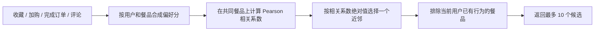

# 智能饮食推荐系统 · User-CF

本科毕业设计，面向大学城点餐场景。原系统用 Spring Boot、MyBatis、MySQL 和 Vue 2 实现用户、商家和管理员三端。推荐模块从收藏、加购、已完成订单和评论提取偏好，在首页「猜你喜欢」展示结果。


*原系统界面截图。作品集还提供了可以切换示例行为的推荐演示。* [打开作品集并选择「智能饮食推荐系统」](https://young-recipe-72cc.gjh-cs24.workers.dev/)

## 推荐怎么得出



基础分为 1，收藏加 1，加购加 2，完成订单加 3，评论加 2。同一行为出现多次只记一次，无行为的用户与餐品组合不进入偏好表。原系统用 `GET /goods/recommend` 提供推荐，首页、搜索和分类页复用这个接口。

## 在本地复跑推荐示例

[Java 示例](demo/RecommendationDemo.java)使用合成行为数据，复现偏好打分、选近邻和候选过滤。需要 JDK 8 或更高版本，进入仓库根目录后运行：

```text
mkdir out
javac -encoding UTF-8 -d out demo/RecommendationDemo.java
java -cp out RecommendationDemo
```

示例中，南瓜粥、鸡丝面、番茄饭的当前用户偏好分分别为 7、3、2。用户 A 更接近当前用户，并与菌菇粥有过交互，因此菌菇粥成为候选。

按绝对值排序会把强负相关也视为接近。示例保留这一原实现规则，分数并列时取示例输入中先出现的近邻。新用户没有历史偏好时返回空列表。

## 归档范围

本仓库收录项目案例、原界面截图和为展示重新编写的 Java 示例。原毕设基于已有脚手架扩展，归档里的 `CoreMath` 标注了「B站 UP：武哥聊编程」。完整脚手架、原数据库备份及上传文件留在本地。Java 示例可以独立运行，原 Web 系统需要另行配置。
