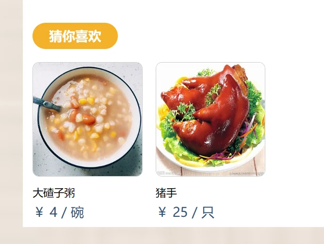
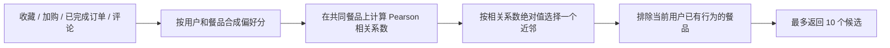

# 智能饮食推荐系统 · User-CF

这是面向大学城点餐场景的本科毕业设计。仓库收录原 Spring Boot / MyBatis 后端、Vue 2 前端和 MySQL 表结构。用户端支持餐品浏览、收藏、加购、下单和评论，商家端管理餐品与订单，管理员端维护平台数据。



*原系统「猜你喜欢」截图。* [查看作品集里的交互案例](https://young-recipe-72cc.gjh-cs24.workers.dev/)

## 推荐在原系统里怎么跑



1. [GoodsController](springboot/src/main/java/com/example/controller/GoodsController.java) 提供 `GET /goods/recommend`。
2. [GoodsService](springboot/src/main/java/com/example/service/GoodsService.java) 从 MySQL 读取行为。基础分为 1，收藏加 1、加购加 2、完成订单加 3、评论加 2。同类行为有记录就加一次。只有发生过交互的组合进入偏好表。
3. [UserCF](springboot/src/main/java/com/example/utils/UserCF.java) 调用 [CoreMath](springboot/src/main/java/com/example/utils/CoreMath.java) 计算相关性，取一个近邻，剔除当前用户已经交互过的餐品。
4. [首页](vue/src/views/front/Home.vue)、[搜索页](vue/src/views/front/Search.vue)和[分类页](vue/src/views/front/Type.vue)调用同一接口并展示候选。

原实现按相关系数绝对值选近邻，因此强负相关也可能被选中。新用户没有历史偏好时，候选列表为空。

## 本地运行

需要 JDK 8、Maven、MySQL 8 和 Node.js 20/npm。项目配置默认将服务绑定到本机。

**准备数据库。** 用 MySQL 客户端执行下列命令，文件路径以仓库根目录为准。脚本在专用数据库 `food_recommendation_demo` 中创建表和演示数据。请用一个空库进行首次导入。

```sql
SOURCE sql/schema.sql;
SOURCE sql/demo-data.sql;
```

**启动后端。** 另开 PowerShell，在 `springboot` 目录设置有权访问演示数据库的 MySQL 账号。

```powershell
$env:FOOD_DB_USER = '你的本地数据库用户名'
$env:FOOD_DB_PASSWORD = '你的本地数据库密码'
mvn spring-boot:run
```

**启动前端。** 在 `vue` 目录另开终端，运行 `npm ci` 和 `npm run serve`。打开 [本地界面](http://127.0.0.1:8080/login)，选择「用户」，用 `demo-reader` / `demo-local-only` 登录。首页「猜你喜欢」预期出现「菌菇粥」，这条推荐来自另一位合成用户的交互。

[Java 算法演示](demo/RecommendationDemo.java)也可以单独编译运行，用于只看计算过程。原项目基于课程脚手架扩展，保留了 `CoreMath` 中「B站 UP：武哥聊编程」的署名。数据库结构来自原归档，演示账号、餐品和交互是重新构造的。
